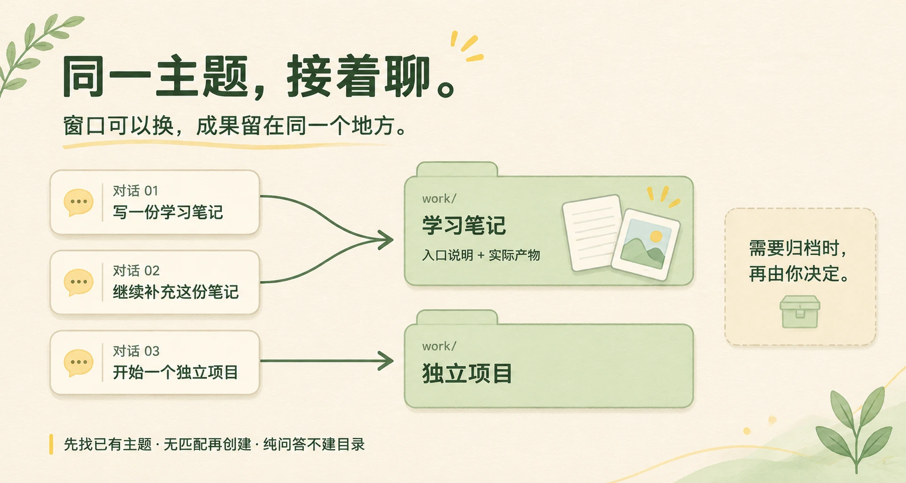
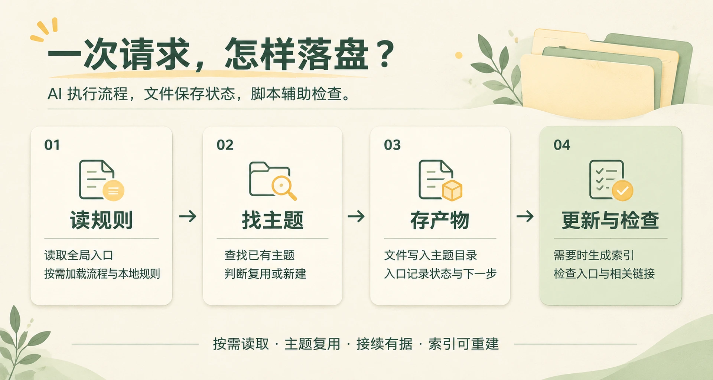

# AI Workspace Kit

把多个 AI 聊天产生的笔记、图片和代码，放回各自的主题。换个窗口，也能找到旧成果继续做。

`v0.2.1` · [MIT](LICENSE) · 索引工具使用 Python 3.9+ 标准库

## 一句话安装

在准备存放 AI 产物的文件夹中打开 AI 编程助手，发送：

```text
请读取 https://github.com/LinyiAIGC/ai-workspace-kit 的 README，按“AI 安装协议”把当前目录配置为 AI 工作区。
```

也可以将“当前目录”换成明确路径。AI 会读取六个模板文件，保留已有内容，并在遇到冲突时询问。

已在 Codex 中实测安装和日常使用流程；其他客户端尚未逐项验证。

## 按主题，接着聊



- **同一件事，沿用一个目录。** 保存前先找已有主题；无匹配再创建，纯问答不建目录。
- **接续信息留在主题里。** 入口记录目标、产物和下一步，新聊天从这里继续。
- **完成后保持原位。** `work/` 可以保留已完成的主题；明确要求归档时，才移到 `archive/`。

## 它怎样工作



根 `AGENTS.md` 保持简短，具体流程放在 `.agents/workspace.md` 按需读取；你的偏好写在 `.agents/local.md`，升级时保留。

每个主题的 `CONTEXT.md` 或 `README.md` 保存标题、别名、标签和状态。脚本从这些入口生成根索引，也能按关键词找回旧主题。

<details>
<summary>查看安装后的目录结构</summary>

```text
workspace/
├── AGENTS.md
├── README.md                 # 说明与主题索引
├── .agents/
│   ├── workspace.md          # 通用流程
│   ├── local.md              # 你的本地规则
│   ├── root-allowlist.txt    # 安装前已有的根目录条目
│   └── tools/
│       └── workspace_doctor.py
├── work/
│   └── YYYY-MM-DD-topic/
│       ├── CONTEXT.md 或 README.md
│       └── 实际产物
├── archive/
└── inbox/                    # 用户可选的投放区
```

安装只写入六个管理文件，不预建主题、`work/`、`archive/` 或 `inbox/`。目录在真正需要时创建，代码项目保留自身布局。

</details>

## 日常怎么用

| 你说 | AI 应该做什么 |
| --- | --- |
| “解释一下相对路径，不保存。” | 直接回答，不创建目录 |
| “把解释保存成笔记。” | 查找主题，复用或新建，保存笔记和入口 |
| “继续完善相对路径笔记。” | 找到原主题，读取入口后继续 |
| “这个主题完成了。” | 标记为已完成，保留原路径 |
| “把这个主题归档。” | 整体移入 `archive/`，更新状态、索引和相关链接 |
| “检查一下工作区。” | 运行检查，报告错误和警告 |

也可以在**安装后的工作区根目录**运行：

```text
python .agents/tools/workspace_doctor.py find "关键词"
python .agents/tools/workspace_doctor.py check
python .agents/tools/workspace_doctor.py index --write
```

`find` 和 `check` 只读；`index --write` 只更新根 README 的索引标记区块。命令中的 `python` 可按环境改为 `python3` 或 `py -3`。

## AI 安装协议

**执行安装或升级的 AI：先完整读取 [安装与维护](docs/installation.md)，再按其中的“AI 安装协议”操作。** 联网读取时使用与本 README 相同分支或标签下的文档。

该文档包含六文件清单、已有内容合并、客户端接入、升级、旧版迁移和验收。无法读取协议或任一模板文件时停止，不凭首页概述重写模板。

## 使用边界

这是一套规则、文件约定和辅助脚本，需要 AI 客户端读取并遵守。它不提供后台监听、强制写入拦截、完整聊天备份或权限隔离；`archive/` 也不等于独立备份。

## 设计来源

感谢以下资料提供的入口分层和决策留痕思路：

- [write-notes-like-deepseek](https://github.com/czm15053/write-notes-like-deepseek)
- [从 DSH 源码看 DeepSeek Harness 团队是如何维护项目的](https://linux.do/t/topic/2904342)
- [DeepSeek Harness](https://github.com/deepseek-ai/deepseek-harness)
- [OpenAI Codex：AGENTS.md 指南](https://developers.openai.com/codex/guides/agents-md)
